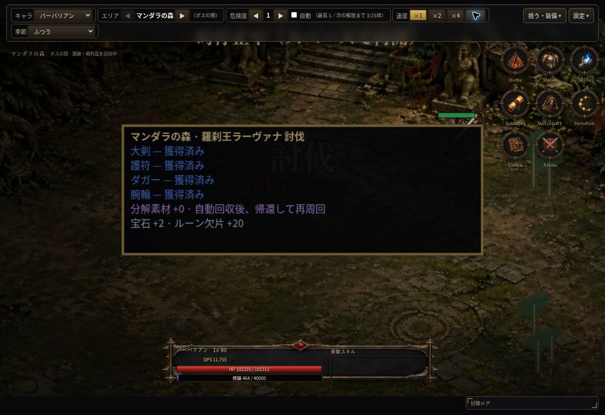
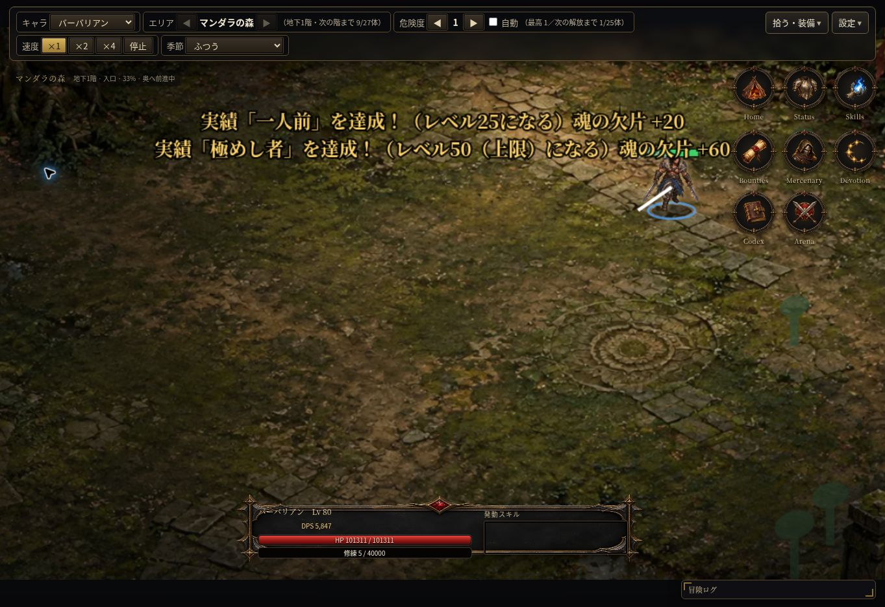

# 自動前進型ダンジョン

基点 main `34ff673`。作業ブランチ `auto-forward-dungeon`。

## 進行

同じ場所で一定数倒す → 次階だった通常冒険を、入口 → 道中 → 奥地 → 次階 → 最奥のボス → 戦利品 → 野営地 → 再周回にする。森を先に検証し、同じ処理を6エリアに設定で展開。手動移動や経路探索なし。

討伐目標は各階の既存値（森27/火葬場40/地底53/聖堂60/氷66/炎72）。通常スポーンは次の境界までの必要数を生存敵と合わせて予約し、討伐達成後に残敵/裂け目を終了して移動。特殊イベントの大量撃破で境界を飛び越えた場合は重複せず一度の移動で追いつく。敵能力/経験値/抽選率は変更しない。

移動は1.1ゲーム秒、軽量設定0.8秒。戦闘更新と新規スポーンを止め、主人公の歩行、既存背景の滑らかなパン、衝突のない外周装飾で奥へ進む。残敵がいない地点で弾・陣・罠などを既存階移動と同様に整理し、召喚は保持して相対移動。前方の出現位置は距離を確保できる場合だけ使用し、無理なら従来位置へ戻す。

## ボスと報酬

既存ボス構図/登場/HP/サウンド/撃破スローを利用し、通常ボスの描画だけに短いカメラ寄りを加える。AI/能力/技は変更しない。

基本4個＋既存ユニーク/セット抽選をそのまま観測する。追加抽選なし。サマリーはアイテムIDに紐づけ、地面・獲得済み・素材化・未受取を区別。分解素材と宝石/ルーン欠片/地図/鍵は実処理の増加だけ表示（実績素材は別の既存通知）。最新1件を保持し、冒険ログに装備名も残す。

ボス撃破後3ゲーム秒（軽量1.4秒）で、残敵/ドロップの回収を終えて野営地へ戻る。0.8ゲーム秒後、同じエリアの地下1階へ自動再出発。停止/速度設定は既存ループに従い、別タイマーや確認クリックを追加しない。野営地の全快は既存処理を利用。未受取上限に達すれば従来どおり停止する。

## 消失・複製防止

移動前に既存updateDropsを実行し、所持枠・自動装備・自動分解・未受取・宝石返却などの処理を再利用。移動で残った地面品を削除しない。普通品の既存の寿命/満杯ルールは維持。

撃破後は保存用dungeonReturnに未取得品のスナップショットを入れ、所有/未受取とIDで重複除外。読み込みでは新しい抽選をせず回収・帰還を復元する。戻った後もまだ地面に残る品だけはチェックポイントを保持し、解決すれば解除。旧セーブはnull。通常の途中保存では既存の階/討伐進行を保持する。

## 変更ファイル

- `data/dungeon.js`：区間、演出時間、パン/前方位置、6エリア装飾/色、サマリー設定。
- `src/dungeon.js`：通常冒険専用の前進/帰還、報酬観測、復元、描画補助。
- `src/world.js`：進行/スポーン停止との接続、実ドロップの状態観測、移動前回収、死亡/切替の一時状態解除。
- `src/render.js`：既存背景パン、外周装飾、ボスカメラ、ドロップの既存発光強調、報酬サマリー。
- `src/save.js` / `src/main.js`：追加チェックポイントの検証/ID重複除外、オフライン報酬適用後の安全な復元。
- `src/town.js` / `src/ui.js`：拠点切替時の前進状態解除、既存HUDへの区間/進行率表示。
- `index.html` / `arena-engine.html` / `dps-engine.html`：依存ファイル追加。同じ読み込み順を維持。
- `tools/dungeon-state-test.js`：実ゲーム処理をNode VMで検証。
- `tools/dungeon-browser-test.js`：PC/390px/横画面のブラウザ検証を追加。
- `docs/SPEC.md` / `docs/HANDOFF.md` / 本報告・画像：仕様、検証、引き継ぎ。

## 検証

- `node tools/dungeon-state-test.js`：成功。森3周・81体/周・27前進、自然戦闘AI2周（強い検証装備・255.6ゲーム秒）、6エリアの既存討伐数/ボス/基本4個/帰還、12周連続の一時状態/最新報酬保持上限。
- 境界条件：前進時の取得、死亡/拘束/裂け目/未受取上限、弾/設置物整理・召喚保持、描画パンと戦闘乱数0、4+2抽選と二重撃破防止、素材化/自動分解/未受取、地面レジェンドの階移動保持、保存復元/ID重複防止、オフライン報酬後の回収。
- 試練/日替わり/地図/双王は実際の開始→敵撃破→成功を通し、通常進行/サマリー/帰還が混入しないことを確認。対人/訓練の判定と独立フレームの依存一致も確認。
- PCクラウドChrome：森の入口29%→33%前進→道中→地下2階→3階→ボス登場/撃破→装備6個（ユニーク/セット＋基本4個）の取得→野営地→再出発を実プレイ/冒険ログで確認。検証用Lv80/強い装備をゲームのバックアップ読込から使用し、本番セーブには触れていない。
- `node tools/arena-diagnostics.js . /tmp/wyd3-dungeon-arena.json`：既存の7職業×全21組×3回＝63試合を例外なく完了（全63試合決着）。描画なしの対人回帰であり、実画面/全装備の網羅ではない。
- `node --check` / `git diff --check`：成功。
- `node tools/run-tests.js`：2/51成功。Nodeテスト2件が成功、49件はこの環境のChromium未導入で起動前に停止。以前取得したChromeもsocket制限で起動不能。ブラウザテスト本体は未実行。Draft PRとして全回帰の未確認を明記する。

## 限界・残件

### 2026-10-13 再開時の追加検証・修正

- 読み込み時の重複除外用IDと所持済みIDを分離。満杯で地面に残っている装備を「獲得済み」と誤表示しない。復元を繰り返しても地面品を増やさず、実際の取得時にだけ表示を更新する回帰テストを追加。
- 戦利品6件＋素材/追加報酬で、狭い画面のサマリーがCanvas下端を超えないよう位置と文字サイズを制限。320px/390px/PCの描画境界テスト成功（実機表示の代替ではない）。
- `node tools/dungeon-state-test.js`、構文チェック、差分チェック成功。`node tools/run-tests.js` を再実行し2/51成功、ブラウザ49件は起動前に停止。公式Chromeを再取得して起動を試したが、`socket() failed: Operation not permitted`で終了。実ブラウザの追加回帰は未実行、Draftを維持する。

### 2026-10-13 ボス報酬・再読み込みの実画面確認

- 最新試用版をクラウドChromeで検証用バックアップから起動。ボス登場、基本装備4個の「獲得済み」、宝石+2/ルーン欠片+20のサマリー、帰還・次周の地下1階を確認。
- 別の撃破後に再読み込みし、地下1階の野営地へ安全に復元。ゲームの書き出し操作で取得したセーブを解析し、ボス討伐1回、装備IDの重複なし、帰還チェックポイントの解消を確認。本番セーブは変更していない。
- 実画面で一時停止案内が装備一覧を覆う問題を発見し、報酬表示中だけ停止/未受取上限案内を上部へ移動。通常時の停止表示は維持。上部HUDへの隠れを避ける位置・サマリーの最低上端も設定し、320pxで報酬6件と停止案内が互いに重ならない描画テストを追加。最後の位置微調整後の実画面再確認は未実施。
- 追加状態テスト、構文・差分チェック成功。全体テストを再実行し2/51、49件はブラウザ起動前に停止したまま。

実機スマホ/小画面のブラウザ、6エリア全部の実画面、通常育成の所要時間、FPS/実メモリ、全回帰は未確認。390px相当の描画API検証は実機確認の代わりではない。Canvas装飾は初期の簡素な表現であり、新規画像制作は行っていない。P1の狩り目的表示/序盤MAPの報酬バランス調整は未着手。

旧画面キャプチャは未取得。以下は森の縦切り試作での前進表示。

試し用：https://raw.githack.com/0909244a0000-coder/with-your-destiny-3/auto-forward-dungeon/index.html
本番：https://0909244a0000-coder.github.io/with-your-destiny-3/
