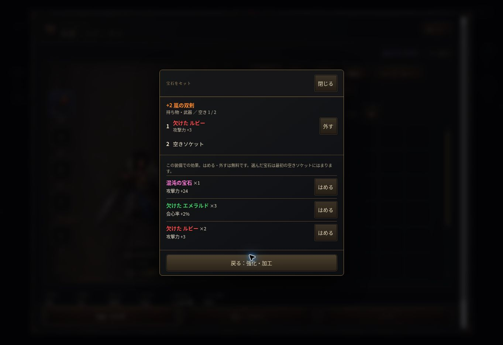

# 個別装備からの宝石セット

基点 main `34ff673`。ブランチ `equipment-gem-picker`。mainへの直接変更なし。

ユーザー画像では、個別装備から宝石画面へ進んだ後、宝石ごとに多数の装備候補から元の装備を探し直していた。

- `src/ui.js`：個別装備の宝石操作を装備窓内の専用選択に変更。対象名・場所・ソケットを固定、手元の宝石を一覧。対象部位の効果と所持数を見て「はめる」で直接装着。最初の空きソケットを使用。外す・装着後も同じ画面を更新して維持、戻るで同じ装備の加工画面へ。満杯でも付け替え入口を出す。
- `src/style.css`：対象とソケットは上部、宝石一覧だけスクロール。44px以上のボタンと折り返しを使用。
- `tools/equipment-comparison-state-test.js`：持ち物/装備中/旧倉庫、部位別説明、通常/混沌/神の宝石、直装着・返却・満杯・ソート・消失・装備交換・連打・神の制限を追加。
- `tools/equipment-comparison-test.js`：宝石管理全体を開かず直接装着し、加工へ戻るブラウザ検証を追加。
- `docs/SPEC.md` / `docs/HANDOFF.md`：仕様と引き継ぎ。

全体の宝石管理・合成画面は残す。性能、神の制限、合成、宝石所持、費用、保存形式は変更しない。既存の `gems.socket` / `unsocketAt` を使用し、操作直前の対象ID照合と連打抑止も再利用する。

検証：Node VMテスト成功、構文・差分チェック成功。`node tools/run-tests.js` は1/49成功、48件はChromium未導入で起動前に停止。ブラウザテスト本体は未実行。前回取得したChromeでも環境のソケット制限で起動できないため、全体回帰は検証待ち。

試し用：https://raw.githack.com/0909244a0000-coder/with-your-destiny-3/equipment-gem-picker/index.html
本番：https://0909244a0000-coder.github.io/with-your-destiny-3/

PC実ブラウザ：クラウドChromeで試用版に検証用セーブを読み込み、持ち物の「+2 嵐の双剣」から加工→宝石セットへ。武器用の効果/所持数と対象固定、エメラルドの直接装着（空き1→0、所持3→2）、満杯での無効化、取り外し（空き0→1、所持2→3）、同じ装備の加工画面への戻りを確認。スクリーンショットを保存。スマホ実機/小画面/全回帰は未確認。

