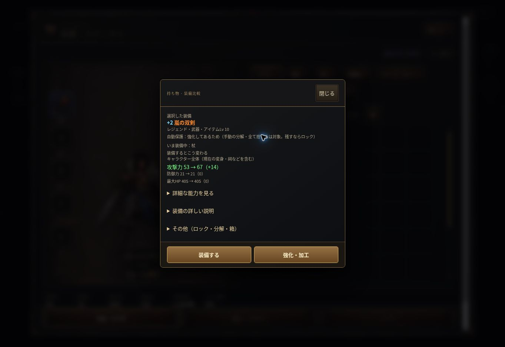

# 装備比較・付け替えUI（2026-10-13）

基点：main `43d3478f6071e882d989db1fb154d8b383b3214a`。ブランチ：`improve-equipment-ui`。mainへのコミット・マージなし。

## 変更

- `src/ui.js`：比較上部に候補名・品質・強化・現装備、既存 `stats.compute` による全体攻撃/防御/最大HP。現在の変身・祠等を同じ条件で適用し、DPSや実戦勝率は推定しない。表示する整数の差と増減値は一致させる。
- 固有能力は旧/候補の説明を表示し「自動評価対象外」。セット部位数・各段階の成立/解除・完成の力の成立/解除を明示。点数は参考表示にし、既存の全能力/特殊効果差分は詳細へ残す。PCの3列ホバーも同じ比較を使用する。
- 最初は判断画面（装備/外す・強化加工・詳細）。ロック/分解/箱は「その他」。加工画面に強化・つけ直し・鍛造・宝石操作を整理。強化とつけ直し後は結果を再表示し加工画面を維持、戻るで同じ装備の判断画面。鍛造/宝石は既存画面へ。
- IDを保存して実行直前に照合。同じ場所のソートはIDを探して追従、場所移動/消失/装備交換は閉じる。素材消費/分解/宝石取り外しは350ms以内の再実行を抑制。無効ボタンからのイベントを拒否。満杯で移動できない場合は状態を維持。
- `src/style.css`：装備窓のみ、説明のスクロールと固定した主操作/閉じるを調整。全体のデザイン変更なし。
- `tools/navigation-ui-test.js`：旧単層前提を二層の遷移へ変更。
- `tools/equipment-comparison-test.js`：PC 1440×900、タッチ相当390×844/844×390で比較/操作/安全性/表示を検証するブラウザテストを追加。
- `tools/equipment-comparison-state-test.js`：ブラウザに依存せず、indexと同じスクリプト順で実ゲームの計算・操作をNode VMに読み込み検証。
- `docs/SPEC.md` / `docs/HANDOFF.md`：今回の仕様と検証制限を記録。

## 操作フロー

以前：選択 → 全説明・比較・全操作が同じ窓 → 操作。

今回：選択 → 主要変化と固有/セットを確認 → 装備する（交換して閉じる）。必要な場合だけ詳細を展開、または強化・加工へ → 加工の結果を見ながら続ける → 戻るで同じ装備の判断へ。

既存の強化・再抽選・鍛造・宝石・分解・箱の処理関数を再利用。自動装備/おすすめ/自動分解/保存ビルド/ルーン/戦闘・性能・費用・セーブ形式は変更していない。現mainは倉庫を廃止しているが、残っている旧倉庫操作経路も維持する。

## 検証

- `node tools/equipment-comparison-state-test.js`：成功。実計算との一致、強化と宝石込みの差分、比較の状態不変、二層操作、IDの並べ替え追従/移動/消失/装備交換、連打抑止、ロック保護、強化/つけ直し/宝石返却、上限/素材不足、鍛造/宝石への遷移、装備/外す/旧倉庫/満杯、セット成立解除/固有能力、自動装備保護・ビルド参照・保存復元を検証。
- `node --check`：変更したJavaScriptすべて成功。`git diff --check`：成功。
- `node tools/run-tests.js`：実行。Chromium未導入の初回は既存47件すべて起動前に停止。
- Chromeを取得して `PLAYWRIGHT_CHROMIUM_EXECUTABLE_PATH=/tmp/wyd3-chrome/opt/google/chrome/chrome node tools/run-tests.js` を実行。結果は **1 / 49 成功**（Node VMのみ）。残り48件はブラウザ起動時に `socket() failed: Operation not permitted` で停止。この実行環境の制約であり、ブラウザのテスト本体は未実行。
- 別のクラウドChromeで試用版を起動し、新規の検証用セーブをゲームの「読み込む」から取り込んでPC表示を手動確認。初期サマリー（攻撃53→67）、強化+2→+3/素材10000→9975と加工画面維持、つけ直し/素材9975→9915、戻る、全差分の展開、装備交換と窓の終了、交換後の実能力（攻撃68）と旧装備の持ち物への返却を確認。ゲーム由来のコンソールエラーなし（ブラウザ拡張由来のエラーを除く）。
- 比較画面のキャプチャ：`2026-10-13-equipment-comparison.jpg`。スマホ実機/タッチ・390px/横画面・ホバー・Escなどの包括的表示検証と既存の全体回帰は未確認。Node VMやPC手動確認の成功を全回帰の代わりには扱わない。

## 未完了・既存の注意点

- マージ前にChromiumが起動できる環境で `node tools/run-tests.js` を実行し、新規ブラウザテスト・既存テストをすべて確認する必要がある。本PRは検証待ちのDraft。
- 既存の宝石画面（`gemvault.click`）ははめ先を場所/インデックスで参照している。表示後の外部移動・並べ替えに対するID照合は今回の装備判断窓と別の課題として残す。
- 既存の鍛造画面はアイテムのオブジェクト参照を保持しており、消失後の所有確認・連打抑止は今回の装備判断窓とは別の課題。機能仕様を変えず、今回に混ぜて改修していない。
- 実機スマホ・スクロール位置/詳細展開の維持は未確認/未対応。大規模なUI改変や戦闘評価器の追加なし。

試し用：https://raw.githack.com/0909244a0000-coder/with-your-destiny-3/improve-equipment-ui/index.html

本番：https://0909244a0000-coder.github.io/with-your-destiny-3/

