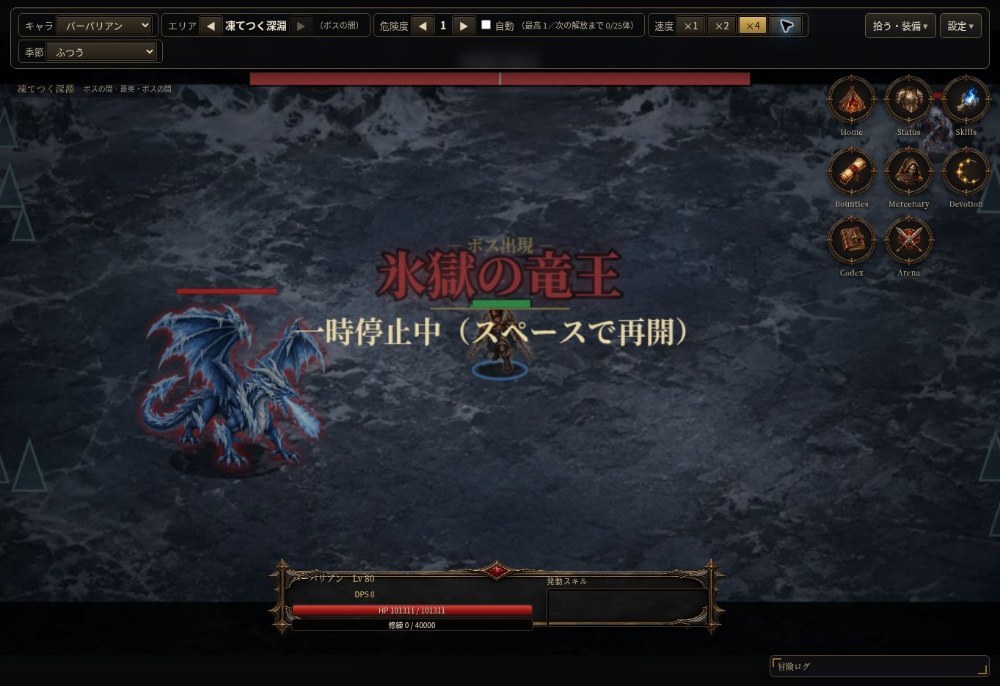

# 凍てつく深淵の実画面確認

2026-10-13。コード68fd17e（ゲーム処理は全51テスト成功のdef68b2と同じ）。クラウドChromeのPC表示で、検証専用Lv80セーブを既存バックアップ読込から使用。本番セーブは変更していない。

- 氷エリアの専用背景と外周の氷柱装飾を確認した。
- 最奥のボスの間に氷獄の竜王が登場し、登場名と上部HPバーが表示された。
- 今回の入場位置では右上メニューとボスが重ならなかった。
- 主人公・ボス・最奥の表示に明らかな表示崩れは見つからなかった。

今回は背景とボス登場の目視のみ。氷エリアの全周回・戦利品・実機スマホ・性能は今回目視していない。コード変更なし。全体51テスト成功の結果を維持する。

[試用版](https://raw.githack.com/0909244a0000-coder/with-your-destiny-3/auto-forward-dungeon/index.html)
