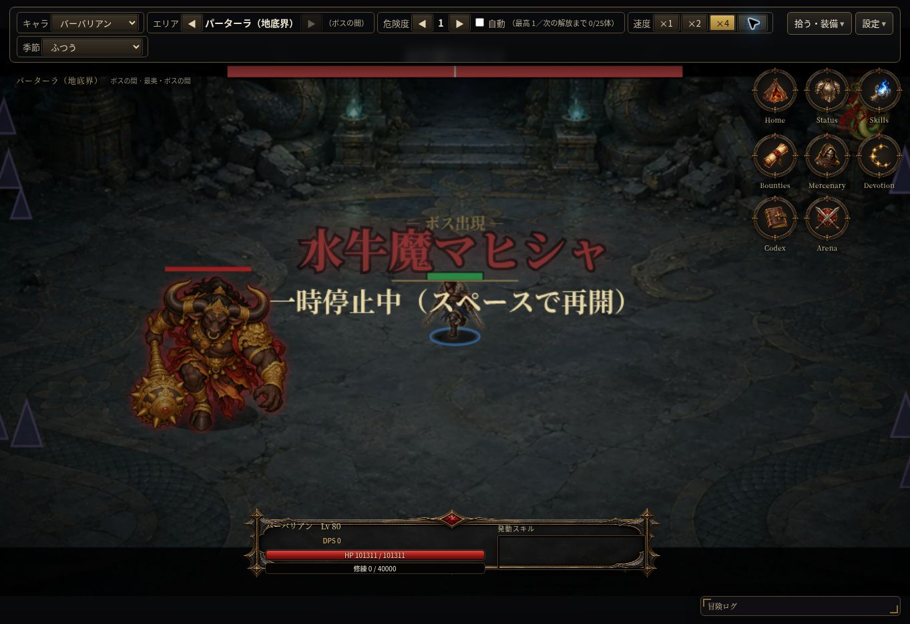

# パーターラの実画面確認

2026-10-13。コードe889fb3（ゲーム処理は全51テスト成功のdef68b2と同じ）。クラウドChromeのPC表示で、検証専用Lv80セーブを既存バックアップ読込から使用した。本番セーブは変更していない。

- 地底界の専用背景と紫の結晶装飾が表示された。
- 最奥のボスの間に水牛魔マヒシャが登場し、登場名と上部HPバーを確認した。
- 今回の通常入場位置では、ボスが右上メニューに重ならず表示された。
- 主人公・ボス・HPバー・最奥の表示に明らかな表示崩れは見つからなかった。

今回は背景とボス登場の目視のみ。パーターラの全周回・戦利品・実機スマホ・性能は今回目視していない。コード変更なし。全体51テスト成功の結果を維持する。

[試用版](https://raw.githack.com/0909244a0000-coder/with-your-destiny-3/auto-forward-dungeon/index.html)
