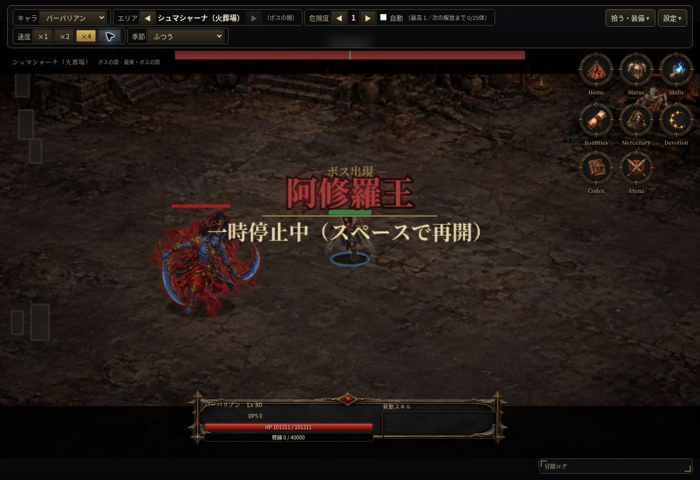
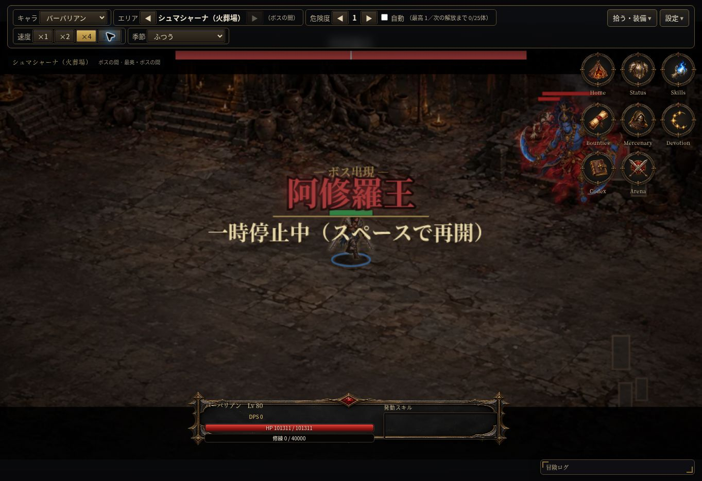

# シュマシャーナの実画面確認

2026-10-13。検証コード `7f5ccbb`。クラウドChromeのPC表示、検証専用Lv80セーブを既存のバックアップ読込から使用。本番のセーブは変更していない。

- 火葬場の専用背景が森と異なる構図・色で表示された。
- ボスの間に阿修羅王が登場し、登場名と上部HPバーが表示された。
- 最奥の表示、主人公とボスの描画、一時停止操作を確認した。
- ボスの一部が右上の既存メニューに重なる場面があった。今回は記録のみで、位置調整は未実施。

今回の範囲は背景とボス登場の目視のみ。シュマシャーナの全周回・戦利品・スマホ実機・性能は今回目視していない。全体自動テスト51件成功の結果は変更なし。

次の小作業候補：通常MAPのボス登場位置と描画カメラを調べ、既存AI・能力を変えずに右上メニューとの重なりを抑えられるか確認する。

## 次の小作業：ボスの登場位置を分離

通常MAPのボスが雑魚と同じ右上の出現位置を使っていたため、ボス用の中央寄りの候補位置をdata/dungeon.jsへ追加。最低出現距離を満たす候補を選び、満たせなければ既存の出現処理へ戻す。雑魚・試練などの位置やAI・能力は変更しない。

状態テストで6エリアの正しいボス、通常入場位置で全カメラ倍率の右上メニュー領域回避、最低距離、HP/攻撃力の維持を確認。クラウドChromeでも同じ検証セーブで阿修羅王が右上メニューから離れて表示されることを確認した（修正コードf2f2f31）。戦闘中のあらゆる位置で重ならない保証ではない。

修正後の[全体回帰実行](https://github.com/0909244a0000-coder/with-your-destiny-3/actions/runs/38333154415)ではMAPの状態/ブラウザ検証は成功。既存の蒐集者と対人ルール検証で失敗があり、再実行と原因確認が残る。前のコードの51/51成功を、この変更後の全件成功とは扱わない。

[試用版](https://raw.githack.com/0909244a0000-coder/with-your-destiny-3/auto-forward-dungeon/index.html)
